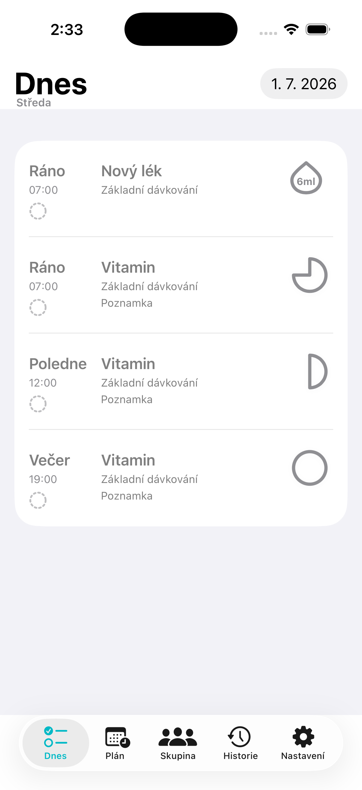
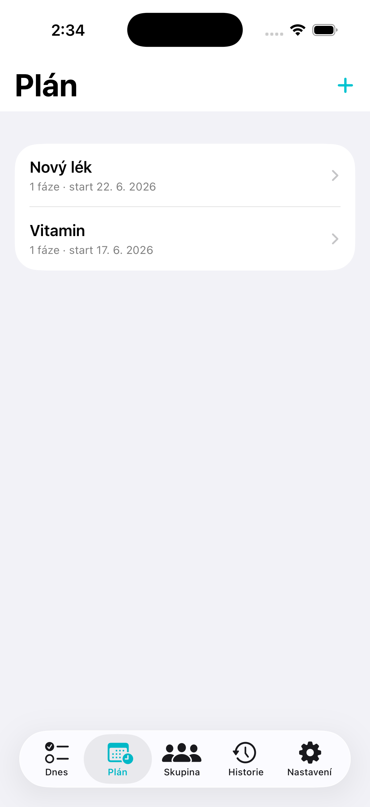
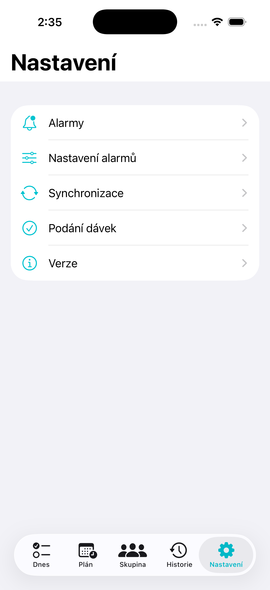

# Pill Care

Pill Care is a SwiftUI iPhone app for coordinating medication schedules and dose confirmations with family members or caregivers through iCloud and CloudKit.

The app is built around a simple rule: CloudKit is the source of truth. Dose confirmations, skipped doses, shared care groups, and shared medication plans are stored as CloudKit records and synchronized across devices instead of being treated as local-only state.

## Screenshots

<table>
  <tr>
    <td align="center"><strong>Today</strong></td>
    <td align="center"><strong>Plans</strong></td>
    <td align="center"><strong>Settings</strong></td>
  </tr>
  <tr>
    <td></td>
    <td></td>
    <td></td>
  </tr>
</table>

## Features

- Create private medication plans with multiple daily dose times and phased dosing.
- Track tablets and syrup doses with distinct dose controls and visual indicators.
- Confirm, skip, and undo dose confirmations from the Today screen.
- Share a care group through the system `UICloudSharingController`.
- Share individual medication plans into a group while keeping personal plans private.
- Preserve dose confirmation history when a plan is shared or removed from sharing.
- Synchronize private and shared CloudKit zones with incremental updates, full recovery paths, and foreground refresh safeguards.
- Enable or disable AlarmKit reminders for upcoming and late-synced doses on each device.

## Architecture

The app separates core business rules from platform infrastructure:

- `Packages/PillCore` contains pure domain models, scheduling logic, access rules, confirmation state handling, and unit tests.
- `PillsAlarm` contains the SwiftUI app, CloudKit repository, AlarmKit scheduling, and UI composition.
- `PillsAlarmTests` mirrors the important domain test coverage for the app target.

CloudKit sync uses zone change tokens for efficient incremental reloads. Authoritative full refreshes are still used for first launch, manual refresh, foreground recovery, token invalidation, and network recovery so that stale local projections do not become the source of truth.

## Requirements

- Xcode 26 or newer
- iOS 17 or newer
- iOS 26 or newer for AlarmKit reminders
- Swift 6
- An Apple Developer account with CloudKit capability

## Apple Capabilities

The app expects the following iCloud container:

```text
iCloud.com.kolisko.pillcare
```

The iOS target must have these capabilities enabled:

- iCloud / CloudKit
- Push Notifications
- Background Modes / Remote notifications

Entitlements are defined in `PillsAlarm/PillsAlarm.entitlements`.

## Alarm Settings

`Nastavení` > `Nastavení alarmů` has one AlarmKit switch. Turning it off cancels all app alarms, including the test alarm; reloads and restarts do not enable it again. Turning it on requests AlarmKit permission and schedules reminders from the current plans. Local notifications are no longer scheduled or used as a fallback. CloudKit silent pushes remain enabled for synchronization.

The setting is local to each device. Existing AlarmKit users remain enabled after upgrading. New installations and the retired local-notification mode start with alarms off. Legacy local notifications are cleared when the app starts or returns to the foreground. No medication or CloudKit record migration is involved.

The `Alarmy Pills` Control Center toggle highlights muting: a red, selected control means alarms are off; the neutral, unselected control means alarms are on. Its label and bell symbol show the actual alarm state. This only inverts the control presentation and action, not the persisted setting. The earlier enabled-value intent remains compatible with cached controls during upgrades.

Cold launches seed the shared control state but only request a control reload when its value actually changes. Enabling uses loaded plans immediately, waits for an existing initial load, or starts a load when none is running. Startup and the intent share this readiness check; other cloud refresh and generation rules are unchanged. The control receives the final state after AlarmKit finishes, not while it is scheduling. Failed off-to-on attempts cancel partial alarms and retain the off preference; cancellation failures remain visible in diagnostics. Disabling never waits for iCloud.

While the intent is running, the stored alarm preference retains its last confirmed on/off value. The control's displayed toggle value follows the pending target so provider reloads preserve WidgetKit's optimistic tint instead of bouncing back to the old color. The same tablet with a question-mark bell and `Zapínání…` or `Vypínání…` indicates that the change is not yet confirmed. All three symbols remain optically centered on the tablet. The value label also maps WidgetKit's optimistic Bool to this pending presentation, before the app starts or a provider reload arrives. A shared snapshot carries the pending state separately from the existing alarm preference and requests that the control be disabled until completion. Failure restores the confirmed value and tint. An OS file lock rejects duplicate control actions even before that disabled template appears, and detects an interrupted process. On the next provider read, an abandoned change (or one older than two minutes) is shown as `Změna nedokončena` with the confirmed value and retry available, not as a successful state change. App startup reconciles an abandoned snapshot with the app preference. WidgetKit controls refresh timing, so recovery is not an exact two-minute timer. No medication records or CloudKit schema change.

`Nastaveni > Alarmy > Diagnostika ovladaciho prvku` keeps the last 300 diagnostic events on the device, including process launches, intent attempts, authorization, cloud reload stages, scheduling results, and control state reads. Each event is atomically persisted in the existing App Group, excluded from backup, and protected until first unlock. The copy action exports timestamps, attempt/process identifiers, version, counts, and error domains/codes, never medication names, doses, CloudKit record contents, or error descriptions. A missing completion event means only that no result was recorded, not proof of a timeout or system termination. Diagnostics are best-effort and do not alter alarm decisions or scheduling behavior.

The sound picker offers `Pípání` (the existing default) and `Pípání a hlas`. Spoken alarms use a complete three-beep phrase from the original sound followed by Czech speech for every dose in the existing aggregated alarm, with pauses between medications. Complete lists repeat with beeps between them within a 29.5-second sound. Remaining space contains complete beep phrases with pauses and a silent ending; a beep is never cut off mid-tone. Tablet fractions and syrup units are expanded for speech. The test alarm follows the selected sound mode and uses the nearest group from the regular alarm planner, including all of its unconfirmed doses and their phase-specific amounts. It uses the same speech builder and audio cache as regular alarms, and fires one minute after audio preparation finishes. If no upcoming doses are available, the test reports this instead of using a fixed message. Regular medication alarms are preserved.

Speech is generated on the device only for groups supplied by the existing scheduler. Completed CAF files in `Library/Sounds` have stable SHA-256 names derived from the spoken content, Czech voice and renderer version. Identical groups reuse the same file across dates, reminders, rescheduling and app restarts. A changed amount, medication name, form or group produces different audio. There is no extra phase preparation or change to cancellation, grouping, repeat rules, scheduling horizon or alarm count.

Speech generation has no time limit: every missing recording is completed in the same scheduling pass. Missing voices, generation errors and lists that cannot fit in full use the original beep and show a warning in alarm settings and the audit. Interrupted files are discarded; medication lists are never truncated. Disabling alarms or superseding a scheduling pass cancels pending synthesis. Sound selection is stored only on the current device.

The top activity line remains visible through iCloud synchronization, speech generation and AlarmKit scheduling. Startup waits for both cloud data and the final alarm pass. Cloud refresh completion callbacks also wait for pending alarm work, including any replacement pass triggered by newer data. Alarm cancellation, aggregation and recreation rules remain unchanged.

## Build And Test

Run the pure core test suite:

```bash
swift test --package-path Packages/PillCore
```

Run the iOS app tests from Xcode or with `xcodebuild`:

```bash
xcodebuild test \
  -project PillsAlarm.xcodeproj \
  -scheme PillsAlarm \
  -destination 'platform=iOS Simulator,name=iPhone 16,OS=latest'
```

## App Icon

The app icon uses the same round tablet and diagonal score as the Control Center toggle, without the bell badge. The blue-green background is preserved. Regenerate all catalog sizes with `swift Tools/generate-app-icons.swift`; use `--check` to validate dimensions, opacity, centering, and score direction without changing files.

## GitHub Automation

This repository uses GitHub Actions for:

- PillCore unit tests
- iOS simulator build/test coverage
- CodeQL analysis
- Dependabot updates for GitHub Actions and Swift Package Manager

## Status

Pill Care is under active development. The production CloudKit schema and App Store/TestFlight deployment are managed separately through Apple Developer and App Store Connect.
